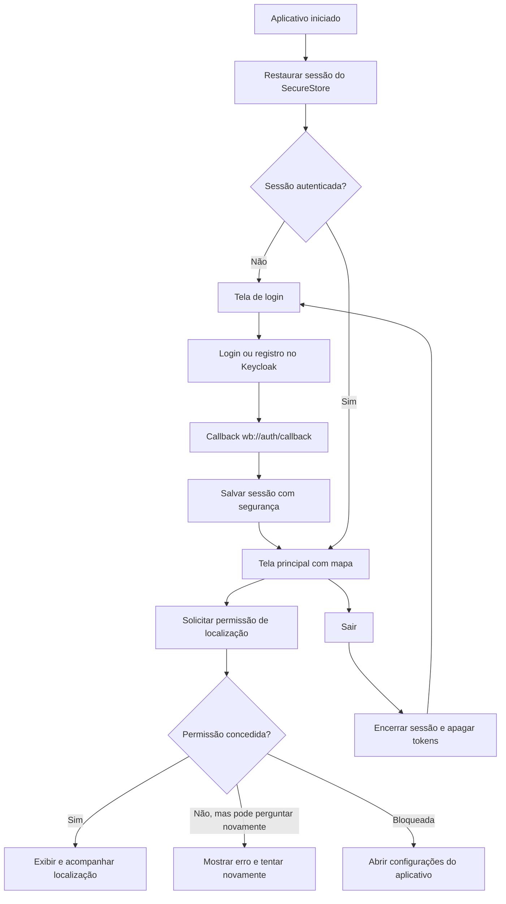
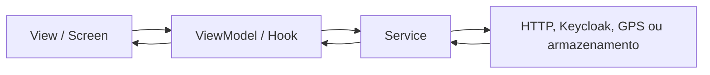

# Smart City

Aplicativo mobile para registro e acompanhamento de ocorrências urbanas. O projeto utiliza React Native com Expo, autenticação pelo Keycloak e arquitetura MVVM.

> Status em 26/10/2026: MVP mobile funcional em Android no ambiente atual, com autenticação, sessão, mapa, GPS, câmera e CRUD integrados. Regressão de unitários, API e E2E aprovada e registrada em `.maestro/README.md`. Banco do Keycloak já migrado para RDS; banco de ocorrências ainda no Supabase, com migração para RDS planejada, conforme confirmação do responsável. Prioridade: preparar e publicar o backend na AWS, integrar Valkey e S3 e validar esse ambiente antes dos refinamentos visuais, iOS e distribuição.

Quadro de acompanhamento: [Projeto 5 SmartCity no Trello](https://trello.com/b/KaOhR9dk/projeto-5-smartcity).
Esta revisão reflete o código local e as evidências já registradas; não representa uma nova execução dos testes nem uma auditoria da infraestrutura.

## Backend no monorepo

O aplicativo permanece em `apps/mobile`; os serviços Express estão em
`apps/backend/demand-service`, `apps/backend/metrics-service` e
`apps/backend/api-gateway`. O mobile continua seguindo MVVM.

As dependências do backend permanecem independentes dos workspaces mobile.
Na raiz, instale-as com:

```powershell
npm --prefix apps/backend/demand-service ci
npm --prefix apps/backend/metrics-service ci
npm --prefix apps/backend/api-gateway ci
```

Use `npm run backend:build` para compilar os três serviços. Para executar
`npm run backend:test`, configure `TEST_DATABASE_URL` para PostgreSQL exclusivo
de testes e prepare seu schema Prisma. Consulte `apps/backend/demand-service/README-TEST.md`.

Para Docker Compose, execute os comandos dentro de `apps/backend`, onde ficam
o Compose e o arquivo local `.env.local` (não versionado). Os caminhos relativos
de build permanecem válidos. Configure o ambiente a partir de `.env.example`.

O workflow de backend fica em `.github/workflows/testes-api.yml` na raiz.
Ele reúne os três níveis em um único job: Jest, Vitest/Supertest e Maestro.
Pode ser acionado manualmente e está agendado diariamente às 00:00 de Fortaleza
(03:00 UTC), na branch padrão. O início pode atrasar conforme a fila do GitHub.
A API e o banco são temporários; o login usa o realm `smartcitys-test`.
Veja `.maestro/README.md` para secrets, ambiente e evidências da execução.

O workflow `.github/workflows/testes-unitarios.yml` executa todos os testes Jest
em cada push de branch e em pull requests para `main`. O check
`Unitários e componentes` deve ser obrigatório na proteção da `main`, com entrada
de alterações por pull request. O Actions verifica o código depois do push;
a proteção impede o merge enquanto os testes não passam.

Para interromper o push local antes do envio quando os testes falharem, ative
o hook versionado em cada clone (com as dependências já instaladas):

```powershell
git config core.hooksPath .githooks
```

Esse hook executa `npm run mobile:test`. A configuração é local e precisa ser
repetida pelos outros membros da equipe; ela não substitui a proteção no GitHub.

O histórico do backend foi incorporado por merge, mantendo seus commits originais.
O repositório original pode ser mantido como referência durante a transição.

## Plataformas suportadas

- Android
- iOS
- Web não faz parte do MVP atual

O desenvolvimento e os testes realizados até agora foram concentrados no Android. A configuração para iOS existe, mas ainda precisa ser compilada e validada em macOS com Xcode.

## Funcionalidades disponíveis

- Login e registro por meio do Keycloak.
- OAuth 2.0/OpenID Connect com Authorization Code e PKCE.
- Restauração automática da sessão ao abrir o aplicativo.
- Renovação de access token com refresh token.
- Armazenamento local dos tokens com Expo SecureStore.
- Proteção de rotas: somente usuários autenticados acessam o mapa.
- Logout e possibilidade de entrar com outra conta.
- Mapa nativo no Android com Google Maps.
- Solicitação da permissão de localização em primeiro plano.
- Acompanhamento da posição do usuário com Expo Location.
- Tratamento de permissão negada ou bloqueada, incluindo atalho para as configurações do celular.
- Cliente HTTP que envia o token do Keycloak ao backend.
- Listagem de ocorrências com `FlatList`, pesquisa textual e filtro de status locais.
- Criação de ocorrência com formulário, localização e foto capturada com Expo Camera.
- Edição e exclusão de ocorrências abertas do próprio cidadão, com confirmação de exclusão.
- Feed de ocorrências com coordenadas exibidas como marcadores no mapa.
- Tema claro e escuro seguindo a configuração do aparelho.

## Fluxo atual de telas



O mapa não possui acesso anônimo: enquanto não houver uma sessão válida, o Expo Router mantém o usuário no grupo de autenticação.

## Fluxo entre as camadas

O projeto segue MVVM e separa apresentação, estado da tela, regras de comunicação e dados.



- **View:** componentes e telas exibidos ao usuário.
- **ViewModel:** controla estado, carregamento, erros e ações da tela.
- **Model:** representa os dados usados pela aplicação.
- **Service:** encapsula integrações com Keycloak, API, GPS e armazenamento.
- **Composition root:** instancia as implementações e conecta suas dependências.

### Fluxo implementado para ocorrências

```text
OccurrenceListScreen / OccurrenceFormScreen / MainMapScreen
        ↓
ViewModels de listagem, formulário e feed
        ↓
OccurrenceService
        ↓
ApiOccurrenceService
        ↓
AuthenticatedFetchHttpClient
        ↓ Authorization: Bearer <access token>
Backend /demands (listagem própria, feed e CRUD)
```

As telas já consomem o backend por meio dos ViewModels e serviços. `appDependencies.ts` monta as dependências de autenticação, cliente HTTP e ocorrências. Pesquisa e filtro de status da listagem são aplicados aos itens carregados; listagem e feed solicitam uma página de até 100 registros, sem carregamento das páginas seguintes.

## Arquitetura e estrutura

O repositório está organizado como monorepo com npm workspaces.

```text
smart-city/
├── apps/
│   └── mobile/
│       ├── app/                 # Rotas do Expo Router
│       ├── src/
│       │   ├── composition/     # Montagem das dependências
│       │   ├── config/          # Configuração da API
│       │   ├── features/
│       │   │   ├── auth/        # Autenticação e sessão
│       │   │   ├── location/    # Integração com GPS
│       │   │   ├── map/         # Tela e ViewModel do mapa
│       │   │   └── occurrences/ # Telas, ViewModels, modelos e serviços
│       │   ├── navigation/      # Proteção e fluxo de rotas
│       │   └── shared/          # Cliente HTTP e erros compartilhados
│       ├── app.config.ts
│       └── package.json
├── packages/                    # Reservado para pacotes compartilhados
└── package.json                 # Scripts e workspaces do monorepo
```

## Tecnologias e versões principais

| Tecnologia | Versão | Uso |
|---|---:|---|
| Expo | 57.0.24 | Plataforma e ferramentas nativas |
| React | 19.2.3 | Componentes e estado |
| React Native | 0.86.3 | Aplicativo mobile |
| TypeScript | 6.0.3 | Tipagem estática |
| Expo Router | 57.0.22 | Navegação baseada em arquivos e rotas protegidas |
| Expo Auth Session | 57.0.12 | Fluxo OAuth/OIDC com PKCE |
| Expo SecureStore | 57.0.4 | Armazenamento seguro dos tokens |
| Expo Location | 57.0.19 | Permissão e acompanhamento do GPS |
| Expo Camera | 57.0.5 | Captura de fotos das ocorrências |
| React Native Maps | 1.27.2 | Exibição do mapa nativo |
| Expo Dev Client | 57.0.19 | Build de desenvolvimento com módulos nativos |
| React Navigation | 7.x | Navegação utilizada pelo Expo Router |
| ESLint | 9.25.0 | Análise estática do código |

Também são utilizados Expo Linking, Expo Web Browser, Reanimated, Gesture Handler, Safe Area Context e React Native Screens.

## Identificação do aplicativo

| Campo | Valor |
|---|---|
| Versão | `1.0.0` |
| Scheme | `wb` |
| Android package | `com.darkartsbm.smartcitys` |
| iOS bundle identifier | `com.darkartsbm.smartcitys` |
| Callback de autenticação | `wb://auth/callback` |

## Pré-requisitos

- Node.js e npm.
- Android Studio e Android SDK para Android.
- `ANDROID_HOME` apontando para o SDK do Android.
- Emulador Android ou aparelho com depuração USB habilitada.
- JDK compatível com o Android Gradle Plugin utilizado pelo Expo.
- macOS com Xcode para compilar a versão iOS.
- Cliente público configurado no Keycloak com PKCE e callback `wb://auth/callback`.
- Maps SDK for Android habilitado no Google Cloud.
- Chave do Google Maps restrita ao pacote e ao certificado SHA-1 do build.

Este projeto usa módulos nativos. Para o fluxo completo, utilize um development build; o Expo Go não representa o ambiente final do aplicativo.

## Configuração do ambiente

Na raiz do repositório, instale as dependências:

```bash
npm install
```

Crie `apps/mobile/.env.local` com base em `apps/mobile/.env.example`:

```env
EXPO_PUBLIC_KEYCLOAK_ISSUER=https://keycloak.exemplo.com/realms/seu-realm
EXPO_PUBLIC_KEYCLOAK_CLIENT_ID=seu-client-id
GOOGLE_MAPS_ANDROID_API_KEY=Sua_chave_google_aqui
EXPO_PUBLIC_API_URL=http://SEU_HOST_LOCAL:8080
```

### Variáveis

| Variável | Finalidade |
|---|---|
| `EXPO_PUBLIC_KEYCLOAK_ISSUER` | Endereço público do realm do Keycloak |
| `EXPO_PUBLIC_KEYCLOAK_CLIENT_ID` | Identificador do cliente público mobile |
| `GOOGLE_MAPS_ANDROID_API_KEY` | Chave usada pelo Maps SDK nativo no Android |
| `EXPO_PUBLIC_API_URL` | Endereço base do backend da aplicação |

Não envie `.env.local` ao Git. Variáveis `EXPO_PUBLIC_*` e a chave utilizada pelo Maps no aplicativo não devem ser tratadas como segredos ocultos no APK. A chave do Maps deve ser protegida por restrições de aplicativo, pacote, SHA-1, API e cotas no Google Cloud.

Ao testar em um celular físico, não use `localhost` para o backend. Use o IP do computador na rede local, por exemplo `http://192.168.0.10:8080`, e mantenha celular e computador na mesma rede.

## Como executar

Todos os comandos abaixo devem ser executados na raiz do monorepo.

### Android

Compile, instale e abra o development build:

```bash
npm run mobile:android
```

Depois que o development build estiver instalado, inicie somente o Metro nas próximas execuções:

```bash
npm run mobile
```

Com o Metro aberto, pressione `a` para abrir no Android quando necessário.

### iOS

Em um Mac com Xcode:

```bash
npm run mobile:ios
```

A versão iOS ainda precisa de validação e da configuração do provedor de mapas escolhida para essa plataforma.

### Verificação do código

```bash
npm run mobile:lint
npm run mobile:test
npm run mobile:test:coverage
```

### Testes automatizados

A suíte mobile respeita as fronteiras do MVVM:

- testes unitários validam mapeadores e ViewModels com serviços injetados;
- testes de componentes validam a ligação entre View e ViewModel;
- o fluxo Maestro valida autenticação, formulário, GPS, backend e listagem em
  um aparelho ou emulador real.

Os testes Jest não acessam Keycloak, câmera, GPS, banco ou API reais:

```bash
npm run mobile:test
```

Para gerar o relatório de cobertura em `apps/mobile/coverage`:

```bash
npm run mobile:test:coverage
```

O teste E2E necessita de credenciais exclusivas de teste e cria uma ocorrência
real no ambiente configurado. As instruções completas estão em
`.maestro/README.md`.

## Serviços externos

O fluxo atual depende de:

- **Keycloak:** autenticação, registro, tokens, renovação e logout.
- **Google Maps Platform:** mapa nativo no Android.
- **GPS do dispositivo:** localização obtida por Expo Location.
- **Backend da aplicação:** integrado às telas de ocorrências e ao feed do mapa.

O APK contém apenas o frontend. Para que as ocorrências funcionem fora da rede local, o backend deverá estar publicado em uma URL HTTPS acessível pelo celular.

## Infraestrutura AWS definida

Decisão do responsável em 26/10/2026: a infraestrutura de destino do backend será AWS, com EC2, RDS PostgreSQL, ElastiCache com Valkey e S3. A escolha dos serviços está definida; sua implantação e integração ainda precisam ser concluídas e validadas.

| Componente | Situação atual confirmada | Destino e responsabilidade |
|---|---|---|
| Execução do backend | Serviços existentes no monorepo; servidor para publicação ainda pendente | EC2 para executar `api-gateway`, `demand-service` e `metrics-service` |
| Banco do Keycloak | Migração para RDS concluída, informada pelo responsável | RDS; persistência de identidade separada dos dados de ocorrências |
| Banco de ocorrências | PostgreSQL no Supabase, informado pelo responsável | Migrar estrutura e dados para RDS PostgreSQL, preservando o schema `demand` e a integração Prisma |
| Cache e comunicação entre serviços | Redis local no Docker Compose; código usa cache, lista de eventos e pub/sub | ElastiCache com Valkey; configurar conexão e validar os comandos utilizados |
| Fotografias | Captura e envio em base64 no MVP | S3 para os arquivos; banco guarda a chave/referência do objeto |
| Acesso do aplicativo à API | Publicação externa ainda pendente | Domínio e HTTPS para o gateway na infraestrutura AWS |

Fluxo de destino: aplicativo → gateway na EC2 → serviços de ocorrências/métricas → RDS e ElastiCache/Valkey. O fluxo de fotos utilizará S3, com autorização controlada pelo backend. O aplicativo continua autenticando pelo Keycloak existente.

Ainda serão definidos região, recursos existentes que podem ser reutilizados, tamanho da EC2, configuração do RDS e do ElastiCache, domínio, terminação HTTPS e processo de publicação. Usar RDS para os dois contextos não define se compartilharão a mesma instância; dados e credenciais de Keycloak e ocorrências devem permanecer separados.

### Preparação e critérios de conclusão

- **Inventário:** identificar recursos AWS já disponíveis, rede e acesso administrativo antes de criar ou alterar serviços. O histórico de configuração de Supabase, Neon e Lightsail no Trello não comprova a implantação do backend no destino definido.
- **Migração Supabase → RDS:** planejar backup, compatibilidade, transferência de estrutura/dados, usuários e permissões, conferência de registros/relacionamentos/sequências e retorno ao ambiente anterior em caso de falha. Definir a janela de troca; atualizar as conexões de ocorrências e métricas somente após validar o destino. Manter a origem até concluir o aceite.
- **EC2 e Valkey:** preparar a execução dos três serviços, configurar suas conexões e validar health checks, cache, publicação/assinatura e consumo da lista de eventos. O Compose atual ainda aponta para Redis local; a configuração AWS precisa ser preparada separadamente, incluindo TLS/autenticação conforme os recursos escolhidos.
- **S3:** definir bucket, permissões da aplicação e acesso autorizado às imagens; implementar envio, persistência da referência, leitura e tratamento de falhas/exclusão. Definir também o tratamento das fotos base64 existentes. Escolher S3 não significa que a integração já está implementada.
- **Publicação:** configurar rede e regras de acesso, identidade IAM da EC2, segredos, domínio/HTTPS, logs, backups e procedimento de implantação/retorno; definir permissões entre EC2, banco, Valkey e S3.
- **Aceite AWS:** validar API, autenticação, CRUD, fotos e métricas no ambiente publicado e repetir a regressão aplicável com dados exclusivos de teste. A aprovação anterior da CI utiliza API/banco temporários e não comprova o funcionamento dessa nova infraestrutura.

Esta seção documenta a decisão e o trabalho pendente. Não foram provisionados recursos, migrados dados ou alteradas configurações de execução nesta atualização.

## O que falta para o MVP

- [x] Criar o ViewModel da listagem de ocorrências.
- [x] Criar a tela de listagem com `FlatList`.
- [x] Integrar a listagem ao endpoint autenticado do backend.
- [x] Exibir ocorrências com coordenadas no mapa.
- [x] Implementar criação de ocorrência.
- [x] Capturar foto com Expo Camera durante a criação.
- [x] Enviar localização e dados da nova ocorrência ao backend.
- [x] Implementar pesquisa e filtros locais.
- [x] Implementar atualização de ocorrência aberta.
- [x] Implementar remoção de ocorrência aberta com confirmação.
- [x] Tratar estados vazios, carregamento e erros das telas de ocorrências.
- [ ] Refinar a tela inicial de login e a apresentação do aplicativo.
- [ ] Refinar os componentes visuais, incluindo o botão de logout.
- [ ] Adicionar atalhos no mapa para criar ocorrência e recentralizar a localização.
- [ ] Validar todo o fluxo em Android físico e emulador.
- [ ] Compilar e validar o fluxo no iOS.
- [x] Criar testes unitários dos ViewModels e mapeadores principais.
- [x] Criar testes de componentes das telas principais.
- [x] Preparar fluxo E2E do MVP com Maestro.
- [x] Executar o fluxo Maestro em Android com serviços externos disponíveis (regressão registrada em `.maestro/README.md`).
- [x] Configurar testes unitários por push/PR e regressão diária/manual no GitHub Actions.
- [x] Migrar o banco do Keycloak para RDS (conclusão informada pelo responsável pelo projeto).
- [ ] Migrar o PostgreSQL de ocorrências do Supabase para RDS e validar dados/conexões.
- [ ] Preparar EC2 e publicar gateway, serviço de ocorrências e serviço de métricas.
- [ ] Integrar e validar ElastiCache com Valkey em substituição ao Redis local no ambiente AWS.
- [ ] Integrar fotos ao S3 e definir a migração das imagens base64 existentes.
- [ ] Validar o fluxo integrado e a regressão aplicável no ambiente AWS.
- [ ] Preparar build de distribuição do MVP.
- [ ] Publicar o backend em HTTPS para testes externos.
- [ ] Revisar segredos e configurações de produção antes da publicação.

## Roadmap de continuidade

A sequência abaixo é um plano de trabalho, sem datas assumidas. Seguiremos o modo de aprendizado do `AGENTS.md`: explicar o conceito e o motivo, propor uma pequena alteração, aguardar a implementação pelo usuário e revisar antes de avançar. A arquitetura mobile permanece MVVM.

| Ordem | Etapa | Entregas e critério de conclusão | Estado |
|---|---|---|---|
| 1 | Inventário AWS e banco de ocorrências | Primeiro passo: levantar os recursos AWS existentes e o banco de origem, sem alterações. Depois planejar e executar, em passos separados, a migração Supabase → RDS com conferência dos dados e plano de retorno. | Prioridade atual; Keycloak no RDS já concluído |
| 2 | Execução na EC2 e ElastiCache/Valkey | Preparar os três serviços, conexões ao RDS e Valkey e validar health checks, cache e eventos; configurar rede, permissões e operação. | A fazer |
| 3 | Fotos no S3 | Implementar envio e acesso autorizado às fotos, guardar referências no banco e tratar imagens antigas e falhas. | Destino definido; integração pendente |
| 4 | HTTPS e validação integrada AWS | Publicar o gateway com domínio/HTTPS, configurar o aplicativo e validar autenticação, CRUD, fotos, métricas e regressão aplicável no novo ambiente. | A fazer após preparar os serviços e integrações |
| 5 | Login, mapa e componentes | Refinar login e painel da conta/logout, criar atalhos no mapa para nova ocorrência e recentralização e revisar marcadores/mensagens; preservar MVVM e conferir temas/testes existentes. | Após a infraestrutura; parte funcional já implementada |
| 6 | Aceite manual Android | Registrar aparelho/emulador, versão e evidências de sessão, CRUD, câmera e GPS concedido/negado/bloqueado; corrigir problemas encontrados, um por vez. | Pendente no ambiente de destino; E2E anterior aprovado |
| 7 | Compatibilidade iOS | Em macOS com Xcode, gerar build, conferir mapa, callback de autenticação, câmera e permissões e executar o roteiro crítico com evidências. | Pendente de ambiente e validação |
| 8 | Distribuição do MVP | Definir distribuição, configurar assinatura e identificadores, gerar build instalável e repetir o aceite no ambiente AWS. | A fazer após as validações |

### Pendências de evolução e decisões de escopo

- **Login/registro hospedado no Keycloak:** há um cartão de personalização em desenvolvimento no Trello. O tema não está neste repositório; confirmar o que já foi realizado no servidor antes de planejar alterações. É diferente da tela de entrada do aplicativo.
- **Fotos no S3:** provedor já definido; integração e tratamento das imagens antigas fazem parte da preparação AWS, antes da validação do ambiente de destino.
- **Paginação e filtros de API:** avaliar carregamento das próximas páginas e filtros no servidor. Hoje os filtros da tela atuam apenas nos itens carregados; os seis testes de filtros avançados de API permanecem ignorados e fora do escopo aprovado do plano de testes.
- **Documentação do backend:** o `apps/backend/README.md` ainda descreve o antigo `auth-service` e JWT compartilhado. Deve ser atualizado em uma revisão própria; a autenticação atual usa Keycloak e validação com chaves públicas.
- **Mapa Vivo:** zonas de risco, PostGIS, pontuação de risco, heatmap e alertas permanecem no pós-MVP, conforme o Trello.

### Evidência disponível

O registro em `.maestro/README.md` aponta a execução 38479762930 do GitHub Actions com 31 testes Jest, 24 testes de API e o fluxo MVP Maestro aprovados; seis testes de filtros avançados ficaram ignorados. Isso valida o caminho automatizado registrado, mas não substitui o aceite manual completo nem a validação iOS. A migração do banco do Keycloak para RDS foi confirmada pelo responsável nesta retomada.

## Requisitos acadêmicos acompanhados

| Requisito | Estado |
|---|---|
| React Native com Expo para Android e iOS | Em desenvolvimento; Android validado e iOS pendente |
| Arquitetura MVVM ou MVC | MVVM adotado |
| Integração com backend | Implementada no fluxo de ocorrências |
| Navegação com Expo Router | Implementado |
| Estado com hooks nativos | Implementado |
| GPS com Expo Location | Implementado |
| Câmera com Expo Camera | Implementado |
| CRUD de ocorrências | Implementado para ocorrências abertas |
| Listagem com FlatList ou SectionList | Implementado com FlatList |

## Observações de segurança

- O aplicativo Keycloak é um cliente público e não possui `client_secret` no APK.
- O fluxo de login utiliza PKCE.
- Tokens são armazenados no Expo SecureStore.
- Credenciais de banco de dados pertencem exclusivamente ao backend.
- Segredos reais não devem utilizar o prefixo `EXPO_PUBLIC_`.
- A chave do Google Maps deve ser restringida no Google Cloud.
- Arquivos locais de ambiente não devem ser versionados.

## Estado atual da integração com o backend

O cliente HTTP autenticado atende listagem própria, feed do mapa, detalhes, criação, atualização e remoção. O backend armazena coordenadas opcionais e restringe edição e exclusão às ocorrências abertas pertencentes ao cidadão autenticado. O PostgreSQL de ocorrências está no Supabase e será migrado para RDS. Fotografias ainda são enviadas como base64; a integração planejada usará S3 e o banco guardará a chave/referência do objeto, com acesso autorizado às imagens. A publicação na EC2 e a integração com ElastiCache/Valkey e S3 permanecem pendentes.
