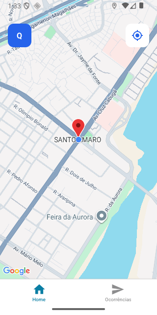
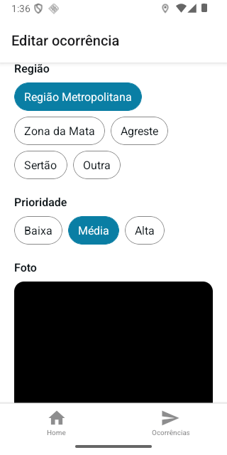
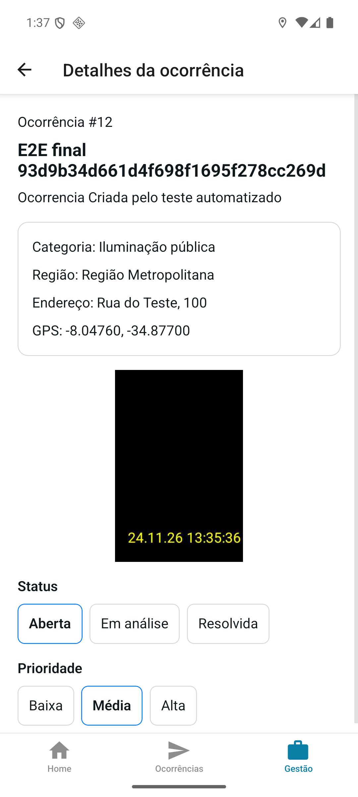
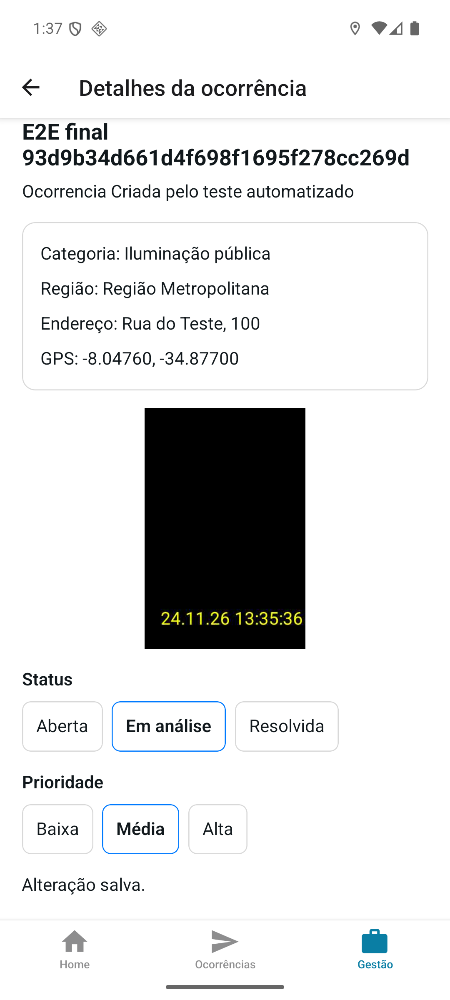
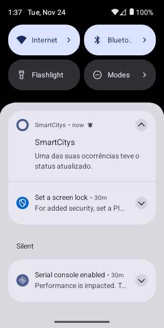
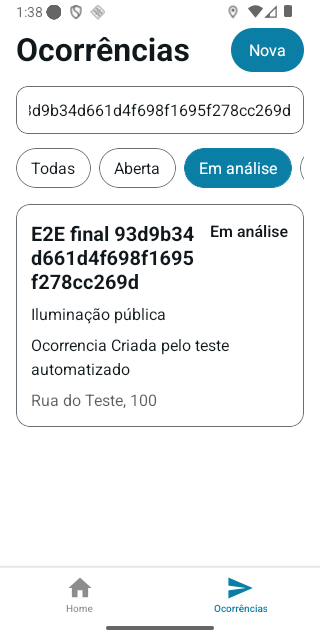

# APK final SmartCitys 1.0.2 — aceite completo em 24/11/2026

**Aprovado: três etapas, zero falhas, saída 0, sem Metro.** A jornada levou
aproximadamente **360.8 segundos (6 minutos)**, em uma execução completa,
com cidadão e ocorrência novos, sem repetir etapas nem substituir ações pela API.
O registro fictício validado foi a ocorrência **#12**.

## APK e rastreabilidade

- [Baixar APK 1.0.2](https://expo.dev/artifacts/eas/wzHDfBIjJpJ1IO0ue4f749Alez2Vzrt7YCiAjulM_Iw.apk).
- [Build EAS concluído](https://expo.dev/accounts/dkartss-team/projects/wb/builds/f0bce9b6-f868-44c0-8b1a-db11d847c50b), perfil e canal `preview`, distribuição interna.
- Código compilado: [18dfe1c](https://github.com/Lobiroka/SmartCitys/commit/18dfe1cf597019c276839764b8db43da7244b223), integrado pela [PR #45](https://github.com/Lobiroka/SmartCitys/pull/45).
- Nome nativo `SmartCitys`, pacote `com.darkartsbm.smartcitys`, versão `1.0.2`, versionCode `3` e runtime `1.0.2`.
- Assinatura verificada com `apksigner`: mesmo certificado do preview 1.0.1. `aapt` confirmou nome/versão e ausência da marca debuggable. O APK contém `assets/index.android.bundle` e a atualização embutida.
- SHA-256 do APK: `a2eacb1759627fc826a9499a489be3386fb67f5ab2b52b77711f5d6e1b7eb20b`.
- [Metadados do build](build.json), [verificação do APK](apk-verification.json), [execução](execution.json), [preparação](preparation.json) e [hashes](sha256.json).

O teste foi iniciado após baixar e conferir o arquivo concluído no EAS. Os horários
do serviço de build e do executor Windows são preservados nas respectivas fontes;
a duração acima utiliza somente os horários do mesmo executor E2E.

## Jornada e resultados

| Etapa | Resultado | Duração do executor | JUnit |
|---|---|---|---|
| citizen-register-and-report | Aprovada | 256.544 s | [citizen-register-and-report.xml](citizen-register-and-report.xml) |
| manager-update | Aprovada | 64.303 s | [manager-update.xml](manager-update.xml) |
| citizen-notification | Aprovada | 39.963 s | [citizen-notification.xml](citizen-notification.xml) |

[JUnit agregado](results.xml). As etapas validam:

1. Cadastro pelo formulário real do Keycloak, logout e novo login; conta com papel cidadão, sem acesso à Gestão.
2. Mapa com ruas carregadas, validação de campos, captura pela câmera, GPS nativo, envio, pesquisa, filtros e reabertura com foto/GPS persistidos.
3. Outro usuário gestor, em outro Android, abre a mesma ocorrência, confere foto/GPS e altera para `EM_ANALISE` pela interface.
4. Push real Expo/FCM recebido na bandeja do cidadão e confirmação do novo status e dos filtros no app.

Não foram usados mocks de autenticação, backend, câmera no JavaScript ou push.
As diferenças entre tempo do Maestro e do executor incluem inicialização e coleta.

## Capturas revisadas

As sete imagens são cópias integrais dos originais da execução, revisadas antes
da publicação. Mostram dados fictícios de testes e não contêm credenciais.

| Evidência | Captura |
|---|---|
| Cadastro e mapa carregado | [](01-cadastro-concluido.png) |
| Novo login e mapa carregado | [](02-login-cidadao.png) |
| Foto recarregada na edição | [](03-foto-gps-recarregados.png) |
| Mesmo registro, foto e GPS no gestor | [](04-gestor-foto-gps.png) |
| Status salvo pelo gestor | [](05-gestor-status-salvo.png) |
| Push real do SmartCitys | [](06-push-real-recebido.png) |
| Cidadão acompanha Em análise | [](07-cidadao-status-atualizado.png) |

## Ambiente, instalação e limites

Dois emuladores Android API 36 dedicados: `emulator-5554` (`SmartCity_API_36`)
e `emulator-5556` (`SmartCity_Gestor_API_36`), com Maestro 2.12.1 e Windows.
O cidadão recebeu instalação limpa; o gestor recebeu atualização com `-r` sobre
o preview 1.0.1, confirmando `versionCode=3` e `versionName=1.0.2` nos dois.
Os antigos pacotes debug tinham assinatura incompatível e foram removidos apenas
dos emuladores de testes durante a preparação. A assinatura de distribuição foi mantida.

O roteiro limpa os dados do app e do Chrome. A preservação de sessões de uma
instalação antiga não foi avaliada; não confundir atualização do instalador com esse aceite.
Todos os encaminhamentos ADB foram removidos antes do teste. O app usou a API
HTTPS compartilhada e o Keycloak real; não foi aberto development client nem Metro.
`execution.json` registra `development_client: false`.

O GPS virtual foi atualizado a cada três segundos em `-8.0476, -34.877`. A imagem
foi produzida pela câmera virtual do Android, com fundo preto e data/hora, e
percorreu captura, upload, persistência e leitura por outro usuário. Não se trata
de uma foto capturada em celular físico. O aceite aqui é em emuladores, permitido
pelo requisito APK/IPA; não comprova homologação em iPhone ou em todos os Androids.

O ensaio cria dados fictícios no ambiente compartilhado. Não houve migration,
deploy AWS ou alteração de credenciais, regras de acesso ou chave Maps nesta entrega.
O APK usa as configurações já cadastradas no EAS e a assinatura existente.

## Reprodução e arquivos locais

Seguir o [guia Maestro](../../../.maestro/README.md). Instalar o mesmo APK nos
dois Androids dedicados, manter o GPS virtual atualizado e fornecer as credenciais
do gestor por arquivo local ignorado. Executar sem `--dev-client` e sem definir
`E2E_DEV_CLIENT=1`:

```powershell
npm.cmd run mobile:test:e2e:final -- `
  --citizen-device emulator-5554 --manager-device emulator-5556 `
  --credentials-file CAMINHO_LOCAL
```

Originais preservados em `test-results/e2e/final-93d9b34d661d4f698f1695f278cc269d/`.
APK e preparação local em `test-results/release-1.0.2/`. Os hashes dos textos
consideram LF, como os arquivos versionados pelo Git. Não há senhas, tokens ou
arquivos de ambiente nesta evidência publicada.

As capturas comparativas U1 × atual e o screencast continuam como materiais
separados da entrega. Este relatório conclui o aceite do APK e da jornada E2E.
